|                      |                               |                               |
| -------------------- | ----------------------------- | ----------------------------- |
| **Junior Bauführer** | **JDWI - Digitale Werkzeuge** |  |

- [1. Excel Grundlagen – Rechnen mit Zeit und Geld](#1-excel-grundlagen--rechnen-mit-zeit-und-geld)
  - [1.1. Lernziele](#11-lernziele)
  - [1.2. Warum rechnen Bauführer mit Zeit und Geld?](#12-warum-rechnen-bauführer-mit-zeit-und-geld)
  - [1.3. Schritt 1: Aufbau der Arbeitsmappe](#13-schritt-1-aufbau-der-arbeitsmappe)
  - [1.4. Schritt 2: Daten sauber erfassen](#14-schritt-2-daten-sauber-erfassen)
  - [1.5. Schritt 3: Formeln, relative Bezüge und Text verbinden](#15-schritt-3-formeln-relative-bezüge-und-text-verbinden)
  - [1.6. Schritt 4: Absolute Bezüge – die Legende festhalten](#16-schritt-4-absolute-bezüge--die-legende-festhalten)
  - [1.7. Schritt 5: Mit Zeit rechnen – der Faktor 24](#17-schritt-5-mit-zeit-rechnen--der-faktor-24)
  - [1.8. Schritt 6: Grundfunktionen und Zahlenformate](#18-schritt-6-grundfunktionen-und-zahlenformate)
  - [1.9. Schritt 7: Runden](#19-schritt-7-runden)
  - [1.10. Schritt 8: Fehler erkennen](#110-schritt-8-fehler-erkennen)
  - [1.11. Schritt 9: Daten mit Pivot auswerten](#111-schritt-9-daten-mit-pivot-auswerten)
  - [1.12. Videos und Unterlagen](#112-videos-und-unterlagen)
- [2. Übungsaufgaben](#2-übungsaufgaben)
  - [2.1. Einstieg: Wo rechnen Sie mit Zeit und Geld?](#21-einstieg-wo-rechnen-sie-mit-zeit-und-geld)
  - [2.2. Geführte Übung 1: Strecken zusammensetzen](#22-geführte-übung-1-strecken-zusammensetzen)
  - [2.3. Geführte Übung 2: Fahrspesen und Lohn](#23-geführte-übung-2-fahrspesen-und-lohn)
  - [2.4. Kontrollrechnung von Hand](#24-kontrollrechnung-von-hand)
  - [2.5. Übung A: Reise vollständig berechnen](#25-übung-a-reise-vollständig-berechnen)
  - [2.6. Übung B: Mit Pivot auswerten](#26-übung-b-mit-pivot-auswerten)
  - [2.7. Vertiefung (optional): Teilstrecken, Pausen, Verpflegung, Unterkunft](#27-vertiefung-optional-teilstrecken-pausen-verpflegung-unterkunft)
  - [2.8. Fehlerjagd](#28-fehlerjagd)
  - [2.9. Transfer: Baustellenfahrten vergleichen](#29-transfer-baustellenfahrten-vergleichen)
  - [2.10. Selbstcheck und Abgabe](#210-selbstcheck-und-abgabe)

---

</br>

# 1. Excel Grundlagen – Rechnen mit Zeit und Geld

## 1.1. Lernziele

Nach diesem Kapitel können Sie:

- [ ] eine Arbeitsmappe mit separater Legende (Ansätze) nachvollziehen und Daten sauber erfassen
- [ ] Zellinhalte mit relativen Bezügen übernehmen und Texte mit `&` verbinden
- [ ] Kosten mit festen Ansätzen aus der Legende berechnen und dabei absolute Bezüge (`$`) einsetzen
- [ ] Fahrzeiten korrekt in Lohn umrechnen (Faktor 24) und Summen über 24 Stunden anzeigen (`[hh]:mm`)
- [ ] die Grundfunktionen SUMME, MITTELWERT, MAX, MIN und ANZAHL anwenden
- [ ] eine Pivot-Tabelle mit gültiger Quelle erstellen, filtern und als PivotChart darstellen
- [ ] Ergebnisse auf Plausibilität prüfen und auf Baustellenfahrten übertragen


---

## 1.2. Warum rechnen Bauführer mit Zeit und Geld?

Fast jede Tätigkeit auf der Baustelle hat zwei Masseinheiten: **Stunden** und **Franken**. Fahrten zur Baustelle, Regiearbeiten, Maschinenstunden oder Lieferungen – immer wird Zeit in Geld umgerechnet.

Die **Reise** dient in diesem Kapitel als einfaches, überschaubares Beispiel: zehn Etappen, je eine Distanz und eine Fahrzeit, daraus Fahrspesen, Lohn, Verpflegung und Unterkunft. Danach übertragen wir dieselben Arbeitsschritte auf **Baustellenfahrten**.

> **Analogie:** Die Reiseplanung ist wie ein Regierapport mit mehreren Einsätzen: Pro Zeile ein Einsatz, pro Spalte eine Kostenart, unten die Summe – und die Ansätze stehen nicht in jeder Zeile, sondern zentral im Tarifblatt.

---

## 1.3. Schritt 1: Aufbau der Arbeitsmappe

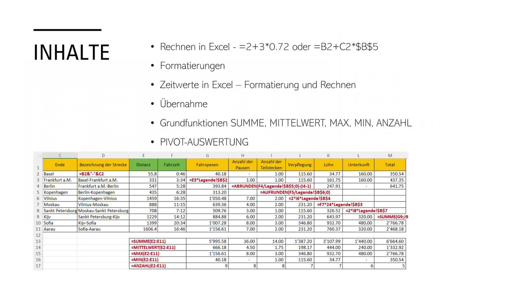

Die Übungsdatei besteht aus vier Blättern:

| **Blatt**               | **Zweck**                                                     |
| ----------------------- | ------------------------------------------------------------- |
| **Legende**             | Ansätze und Zeitvorgaben zentral speichern (das "Tarifblatt") |
| **Reiseplanung Muster** | Fertiges Beispiel mit Ergebnissen zum Vergleichen             |
| **Reiseplanung Spick**  | Formeln zum Nachschlagen – erst zur Kontrolle verwenden       |
| **Reiseplanung Übung**  | Hier erstellen Sie die Berechnungen selbst (`???` ersetzen)   |

Die **Legende** enthält folgende Übungswerte (keine verbindlichen Spesen- oder Arbeitszeitregeln):

| **Zelle** | **Kategorie**          | **Wert**       |
| --------- | ---------------------- | -------------- |
| B2        | Fahrspesen             | 0.72 CHF/km    |
| B3        | Lohn                   | 45.35 CHF/Std. |
| B4        | Verpflegung            | 57.80 CHF/Tag  |
| B5        | Fahrzeit bis zur Pause | 2:00           |
| B6        | Max. Fahrzeit/Tag      | 8:24           |
| B7        | Unterkunft Pauschale   | 80.00 CHF/Tag  |

> **Merksatz:** Ein Ansatz gehört **einmal** in die Legende – nie fest in eine Formel getippt. Ändert sich der Tarif, ändert man genau **eine** Zelle.

---

## 1.4. Schritt 2: Daten sauber erfassen

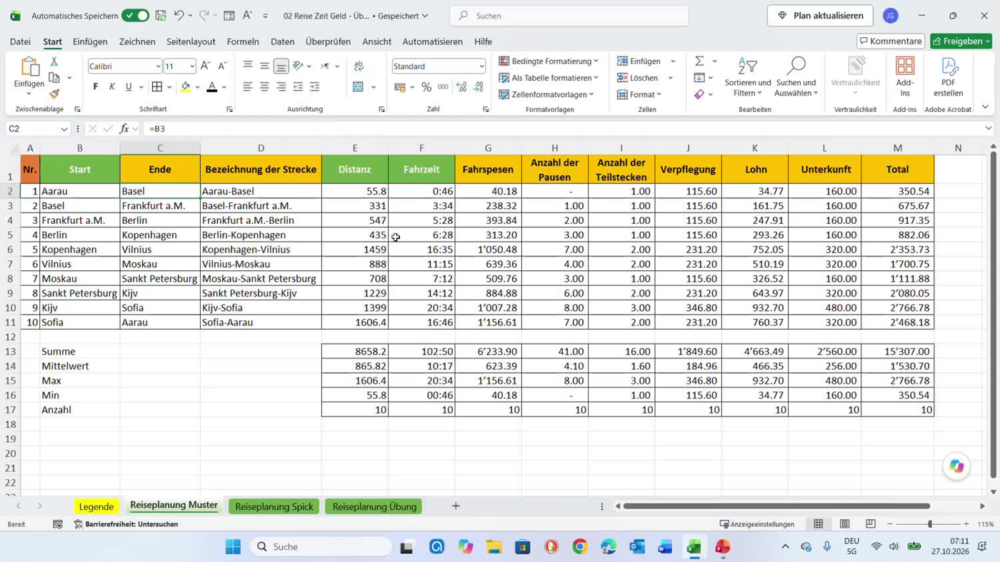

Regeln für eine saubere Tabelle:

- **Eine Zeile = ein Datensatz** (eine Etappe): Start, Ziel, Distanz, Fahrzeit.
- **Eine Spalte = eine Information** mit eindeutiger Überschrift.
- **Zahlen als Zahlen** eingeben: `331`, nicht `331 km`. Die Einheit gehört in die Überschrift.
- **Zeiten als Zeitwert** eingeben: `3:34` (Stunden:Minuten).
- **Keine leeren Zeilen** innerhalb der Daten – sonst erkennt Excel (z. B. für Pivot) den Bereich nicht.

> **Grundregel:** Je einfacher und klarer der Datenaufbau, desto einfacher sind Auswertung, Export und Import der Daten.

**Datenreihe erstellen** (Nummerierung 1 bis 10):

1. In A2 eine `1` eingeben.
2. Am Ausfüllkästchen (kleines Quadrat unten rechts) doppelklicken.
3. In den Ausfülloptionen **Datenreihe ausfüllen** wählen.
4. Ohne benachbarte Daten: **Start → Ausfüllen → Reihe**, Spalten und Endwert festlegen.

---

## 1.5. Schritt 3: Formeln, relative Bezüge und Text verbinden

Jede Formel beginnt mit `=`. Statt Zahlen verwendet man **Zellbezüge** – so rechnet Excel automatisch neu, wenn sich ein Wert ändert.

```text
=2+3*0.72        → rechnet mit festen Zahlen (schlecht wartbar)
=E2*B2           → rechnet mit Zellinhalten (gut)
```

**Relativer Bezug:** Beim Herunterkopieren "wandert" der Bezug mit. Aus `=B3` in C2 wird in C3 automatisch `=B4`.

| **Aufgabe**                      | **Formel in Zeile 2** | **Wirkung**                                 |
| -------------------------------- | --------------------- | ------------------------------------------- |
| Ziel = Start der nächsten Etappe | `=B3`                 | Das Ende einer Etappe ist der nächste Start |
| Strecke zusammensetzen           | `=B2&" - "&C2`        | ergibt `Aarau - Basel`                      |

- Das `&` verbindet Texte. Leerzeichen und Bindestrich stehen in Anführungszeichen.
- Die **letzte Etappe** (Sofia → Aarau) hat keine Folgezeile – hier das Ziel `Aarau` gezielt setzen.

**Daten übernehmen – das Schlüsselzeichen `=`**

Jede Zelle hat eine eindeutige Adresse, z. B. **C21** (C = Spalte, 21 = Zeile). Mit `=` holt man den Inhalt einer anderen Zelle:

| **Woher?**                    | **Formel**                                                                           |
| ----------------------------- | ------------------------------------------------------------------------------------ |
| Gleiches Tabellenblatt        | `=C21`                                                                               |
| Anderes Blatt derselben Mappe | `=Legende!B2` bzw. `='Reiseplanung Muster'!C21` (Blattname mit Leerzeichen in `' '`) |
| Andere Arbeitsmappe           | `='[Tarife.xlsx]Legende'!$B$2`                                                       |

Am einfachsten tippt man nur `=`, klickt die gewünschte Zelle an (auch auf einem anderen Blatt) und schliesst mit **Enter** ab – Excel schreibt die Adresse selbst.

**Daten zusammenführen – das Schlüsselzeichen `&`**

Mit `&` werden Inhalte mehrerer Zellen zu einem Text verbunden. Das Beispiel zeigt die drei typischen Stufen:

1. **Ohne Leerzeichen** – die Inhalte "kleben" zusammen:

   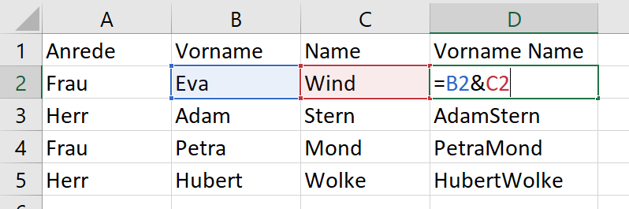

2. **Mit Leerzeichen** – ein Leerzeichen in Anführungszeichen `" "` trennt die Inhalte:

   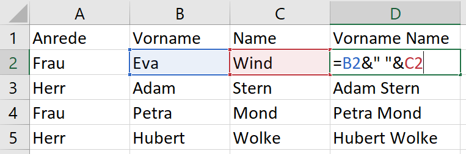

3. **Mit zusätzlichem Text** – eigener Text **muss** in Anführungszeichen stehen:

   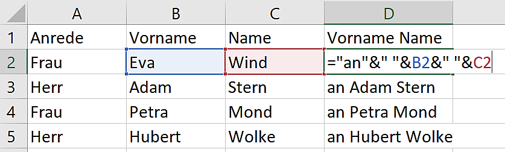

_Quelle: J. Galek, Digital Fit – Modul Office fortgeschritten_

Genau so entsteht in der Reiseplanung die Bezeichnung `Aarau - Basel`: Start `&` `" - "` `&` Ziel. Statt `&` kann auch die Funktion `VERKETTEN` verwendet werden, `&` ist aber kürzer und übersichtlicher.

> **Tipp:** Zelle bearbeiten mit **F2** oder Doppelklick. Spaltenbreite anpassen: Doppelklick auf die Grenze zwischen zwei Spaltenköpfen.

---

## 1.6. Schritt 4: Absolute Bezüge – die Legende festhalten

Die Fahrspesen sind **Distanz × Kilometeransatz**. Der Ansatz steht auf einem anderen Blatt (**Blattbezug**):

```text
=E2*Legende!$B$2
```

Das Dollarzeichen **fixiert** den Bezug. Beim Herunterkopieren wird `E2` zu `E3`, `E4` … – aber `Legende!$B$2` bleibt stehen.

| **Schreibweise** | **Was bleibt fix?** | **Beim Kopieren nach unten** |
| ---------------- | ------------------- | ---------------------------- |
| `B2`             | nichts (relativ)    | wird zu `B3`                 |
| `$B$2`           | Spalte und Zeile    | bleibt `$B$2`                |
| `B$2`            | nur Zeile           | bleibt `B$2`                 |
| `$B2`            | nur Spalte          | wird zu `$B3`                |

- Mit **F4** (auf Laptops oft **Fn+F4**) wechseln Sie zwischen `$B$2` → `B$2` → `$B2` → `B2`.
- Beim Klick ins Blatt _Legende_ die Formel mit **Enter** abschliessen – **nicht** zurück ins Übungsblatt klicken, sonst wird der Klick Teil der Formel.

> **Merksatz:** Was sich **pro Zeile ändert**, ist relativ (`E2`). Was für **alle Zeilen gilt**, ist absolut (`$B$2`).

**Gut zu wissen – mit mehreren Blättern und Mappen arbeiten:**

- Bezüge auf eine **andere Arbeitsmappe** funktionieren nur, solange die Quelldatei **nicht gelöscht, umbenannt oder verschoben** wird. Deshalb gehören Ansätze für ein Projekt am besten in ein Blatt **derselben** Mappe.
- Um _Legende_ und _Reiseplanung_ gleichzeitig zu sehen: **Ansicht → Gruppe Fenster → Neues Fenster**, danach **Alle anordnen** (z. B. vertikal). Mit **Fenster wechseln** springen Sie schnell zwischen allen offenen Excel-Fenstern.

---

## 1.7. Schritt 5: Mit Zeit rechnen – der Faktor 24

Excel speichert eine Uhrzeit oder Dauer als **Bruchteil eines Tages**:

| **Anzeige** | **Gespeicherter Wert** | **in Stunden** |
| ----------- | ---------------------- | -------------- |
| 24:00       | 1                      | 24             |
| 12:00       | 0.5                    | 12             |
| 2:30        | 0.104166…              | 2.5            |
| 3:34        | 0.148611…              | 3.57           |

Rechnet man `2:30 × 45.35`, multipliziert Excel also `0.104166 × 45.35` – das Ergebnis wäre viel zu klein. Deshalb wird die Zeit vorher **mit 24 multipliziert**:

```text
Lohn = Fahrzeit × 24 × Stundenansatz
     = F2*24*Legende!$B$3
```

Beispiel: 2:30 → 2.5 Std. × CHF 45.35 = **CHF 113.38**

> **Merksatz:** **Zeit mal Geld braucht den Faktor 24.**

---

## 1.8. Schritt 6: Grundfunktionen und Zahlenformate

| **Funktion** | **Beispiel (Distanz)** | **Ergebnis**                 |
| ------------ | ---------------------- | ---------------------------- |
| SUMME        | `=SUMME(E2:E11)`       | Alle Werte addiert           |
| MITTELWERT   | `=MITTELWERT(E2:E11)`  | Durchschnitt                 |
| MAX          | `=MAX(E2:E11)`         | Grösster Wert                |
| MIN          | `=MIN(E2:E11)`         | Kleinster Wert               |
| ANZAHL       | `=ANZAHL(E2:E11)`      | Anzahl Zellen **mit Zahlen** |

- Schnellzugriff über das **Σ-Menü** (Start → AutoSumme). Den vorgeschlagenen Bereich immer prüfen!
- **Etappentotal** über getrennte Bereiche: `=SUMME(G2;J2:L2)` (mehrere Bereiche mit `;` oder mit gedrückter **Ctrl**-Taste markieren).

**Zahlenformate**

Jede Zelle hat einen **Inhalt** (Text, Zahl oder Formel) und ein **Format** – die "Verpackung" des Inhalts. Das Format ist oft entscheidend, damit eine Tabelle richtig verstanden wird. Der Dialog **Zellen formatieren** öffnet sich mit **Ctrl+1** (oder Rechtsklick → Zellen formatieren, oder Register Start → Gruppe Zahl → Pfeil unten rechts).

| Standard-Kategorien (Zahl, Datum, Prozent …)                        | Eigene Formate unter **Benutzerdefiniert**                                |
| ------------------------------------------------------------------- | ------------------------------------------------------------------------- |
| 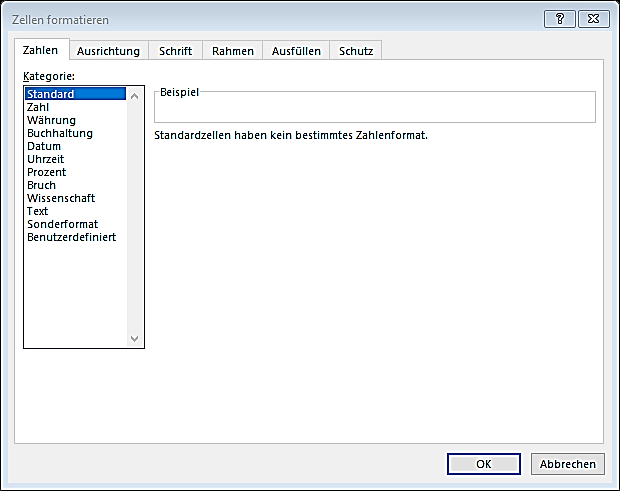 | 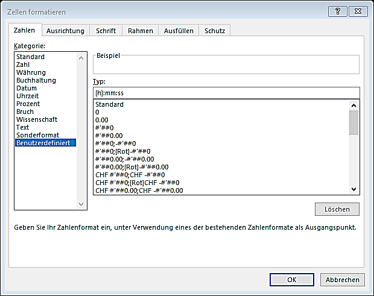 |

_Quelle: J. Galek, Digital Fit – Modul Office fortgeschritten_

Unter **Benutzerdefiniert** tragen Sie im Feld **Typ** z. B. `[hh]:mm` ein (im Bild oben `[h]:mm:ss`). Die eckigen Klammern sorgen dafür, dass Stunden über 24 hinaus gezählt werden.

| **Inhalt**                | **Format**                  |
| ------------------------- | --------------------------- |
| Geldbeträge               | Zahl mit 2 Dezimalstellen   |
| Anzahlen (ANZAHL, Pausen) | Zahl ohne Dezimalstellen    |
| Einzelne Fahrzeit         | `h:mm`                      |
| Summe der Fahrzeiten      | benutzerdefiniert `[hh]:mm` |

Ohne eckige Klammern springt die Anzeige nach 24 Stunden wieder auf 0 – `102:50` würde als `06:50` erscheinen.

> **Wichtig:** Formatieren verändert nur die **Anzeige**, nicht den gespeicherten Wert.

---

## 1.9. Schritt 7: Runden

Runden verändert – anders als Formatieren – den **Rechenwert**:

| **Funktion**               | **Beispiel**                    | **Verwendung**                                |
| -------------------------- | ------------------------------- | --------------------------------------------- |
| `AUFRUNDEN(Zahl;Stellen)`  | `=AUFRUNDEN(F2/Legende!$B$6;0)` | Ein angefangener Reisetag zählt als ganzer    |
| `ABRUNDEN(Zahl;Stellen)`   | `=ABRUNDEN(F2/Legende!$B$5;0)`  | Nur volle 2-Stunden-Blöcke ergeben eine Pause |
| `RUNDEN(Zahl;Stellen)`     | `=RUNDEN(K2;2)`                 | Kaufmännisch auf 1 Rappen runden              |
| `VRUNDEN(Zahl;Vielfaches)` | `=VRUNDEN(M13;0.05)`            | Auf 5 Rappen runden (Schweizer Rappenrundung) |

Die Anzahl **Stellen** bestimmt die Genauigkeit: `2` = auf Rappen, `1` = auf 10 Rappen, `0` = auf ganze Franken bzw. ganze Zahlen. `VRUNDEN` rundet dagegen auf ein **Vielfaches**, z. B. 0.05, 0.10 oder 1.00.

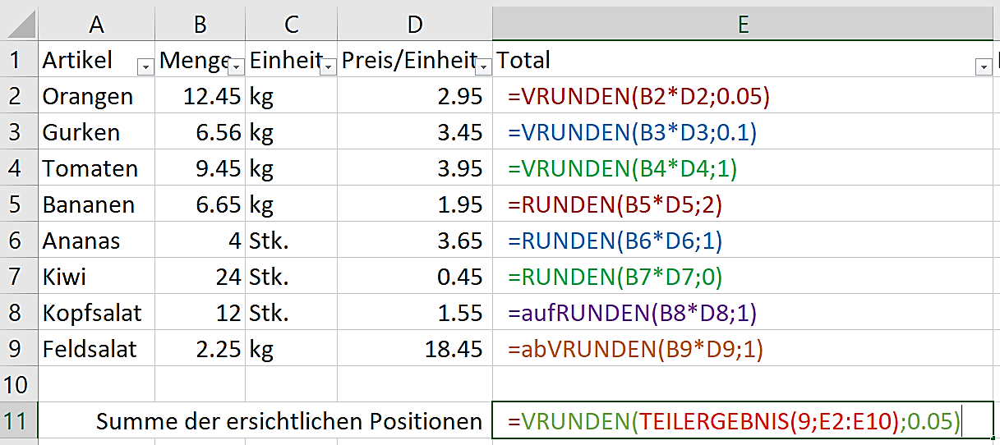

_Quelle: J. Galek, Digital Fit – Modul Office fortgeschritten_

> **Wo runden?** Nicht in jeder Zeile, sondern **möglichst spät** – im Endbetrag. Sonst summieren sich die Rundungsdifferenzen. Im Beispiel oben wird erst die Summe in E11 auf 5 Rappen gerundet. Ausnahme: Wenn die Aufgabe ganze Einheiten verlangt (ganze Teilstrecken, ganze Pausen), muss bereits in der Zeile gerundet werden.

> **Vorgehen:** **Erst rechnen, dann runden.** Zuerst die Division eingeben und kontrollieren, danach AUFRUNDEN/ABRUNDEN darum setzen.

---

## 1.10. Schritt 8: Fehler erkennen

| **Meldung / Symptom**    | **Mögliche Ursache**                                   | **Abhilfe**                        |
| ------------------------ | ------------------------------------------------------ | ---------------------------------- |
| `#WERT!`                 | Eine Zelle enthält Text (z. B. `???`) statt einer Zahl | Platzhalter ersetzen               |
| `#DIV/0!`                | Nenner ist leer oder null                              | Bezug auf den Nenner prüfen        |
| `#####`                  | Spalte zu schmal                                       | Spaltenbreite anpassen             |
| Kosten viel zu hoch/tief | Falscher oder nicht fixierter Bezug auf die Legende    | `$` prüfen, Formel mit F2 anzeigen |
| Lohn viel zu klein       | Faktor 24 vergessen                                    | `*24` ergänzen                     |
| Summe Fahrzeit falsch    | Format `hh:mm` statt `[hh]:mm`                         | Format anpassen                    |

> **Vorgehen:** Erste Formel prüfen, **erst danach** nach unten kopieren. Mit **Formeln → Formeln anzeigen** (Ctrl+`) sehen Sie alle Formeln auf einen Blick.

**Werkzeuge zur Fehlersuche:**

- **F2** zeigt immer den **wahren Inhalt** einer Zelle (die Formel statt des Ergebnisses) und markiert die verwendeten Zellen farbig.
- **Formeln → Gruppe Formelüberwachung → Spur zum Vorgänger** zeichnet Pfeile zu den Zellen, aus denen eine Formel rechnet – ideal, um einen falschen Bezug auf die Legende zu finden.
- **Spur zum Nachfolger** zeigt umgekehrt, welche Formeln eine Zelle verwenden (z. B.: Welche Zellen hängen am Kilometeransatz?). **Pfeile entfernen** räumt wieder auf.

---

## 1.11. Schritt 9: Daten mit Pivot auswerten

Eine **Pivot-Tabelle** fasst eine Datenliste per Mausklick zusammen – ohne eine einzige Formel. Sie liefert Zwischen- und Gesamtergebnisse und beantwortet Fragen wie: _Was kosten die Etappen Berlin–Kopenhagen und Kopenhagen–Vilnius zusammen?_ Ein grosser Vorteil: Es wird **nicht direkt in den Daten** gearbeitet – die Quelldaten bleiben unverändert.

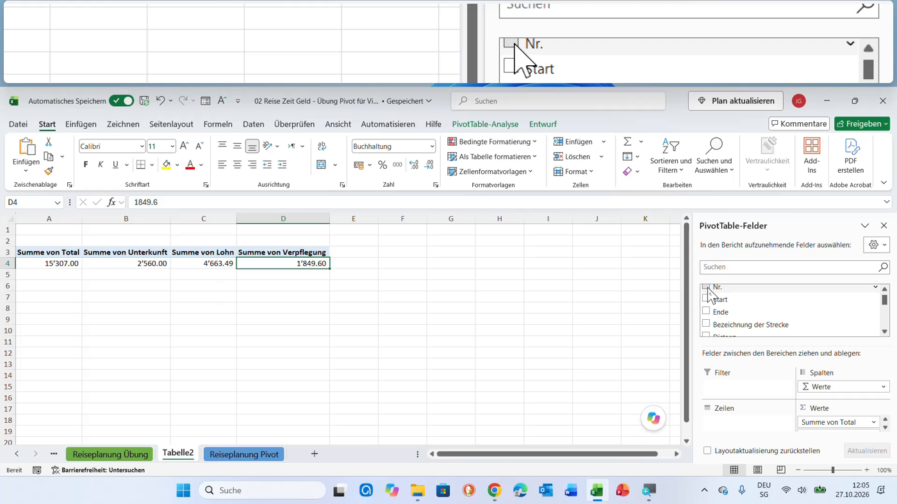

| **Begriff**  | **Bedeutung**                                                          |
| ------------ | ---------------------------------------------------------------------- |
| Quelle       | Zusammenhängende Datensätze mit eindeutigen Überschriften (A1:M11)     |
| Zeilen       | Gruppierung – hier _Bezeichnung der Strecke_                           |
| Werte        | Kennzahlen – hier _Summe von Total, Unterkunft, Lohn, Verpflegung_     |
| Filter       | Auswahl einzelner Strecken                                             |
| PivotChart   | Diagramm der Pivot-Auswertung (F11 bzw. Fn+F11)                        |
| Detailauszug | Doppelklick auf einen Wert → neue Tabelle mit den Datensätzen dahinter |

**Vorgehen:**

1. Eine Zelle **innerhalb** der Daten anklicken (keine Teilmenge markieren).
2. **Einfügen → Gruppe Tabellen → PivotTable**, Quelle kontrollieren: nur Überschriften und die zehn Etappen, **keine Summen- oder Mittelwertzeilen**.

   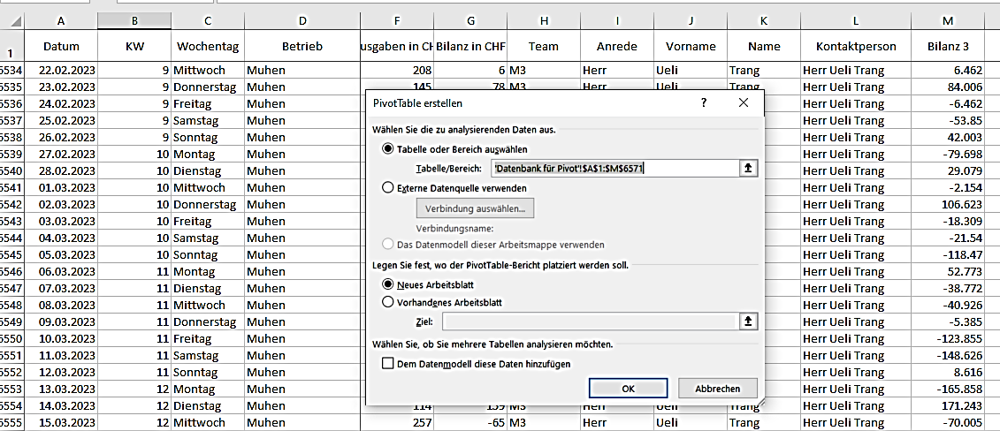

3. PivotTable auf einem **neuen Blatt** einfügen. Excel erstellt eine leere Pivot-Tabelle; rechts erscheint die Feldliste:

   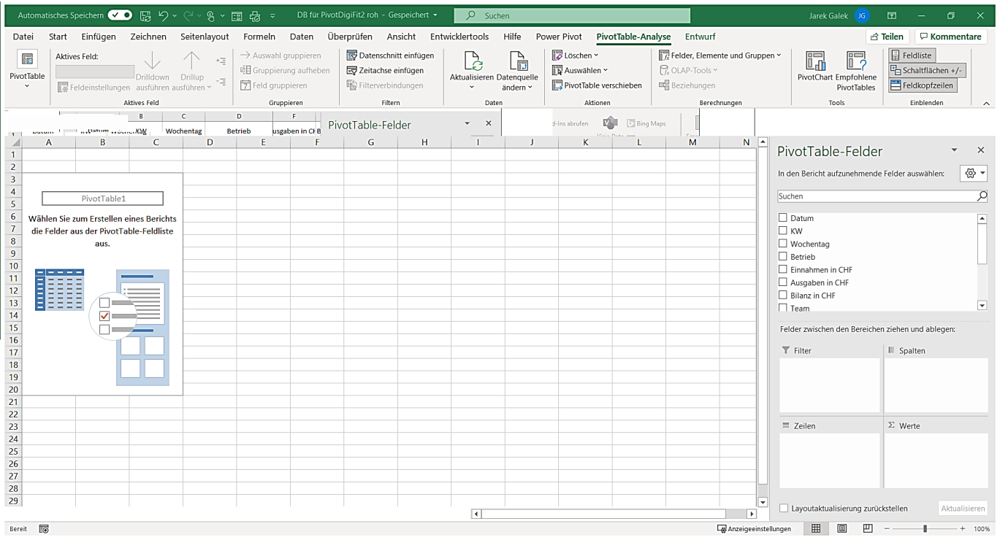

   Die Felder werden in die vier Bereiche gezogen:

   |  | **Werte** (zentral): was berechnet wird, z. B. Summe von Total<br>**Zeilen**: wonach gruppiert wird, z. B. Strecke<br>**Spalten**: zweite Gruppierung nebeneinander<br>**Filter**: Auswahl für die ganze Tabelle |
   | ------------------------------------------------ | ---------------------------------------------------------------------------------------------------------------------------------------------------------------------------------------------------------------- |

   _Quelle: J. Galek, Digital Fit – Modul Office fortgeschritten_
4. Feld _Bezeichnung der Strecke_ in **Zeilen**, Kostenfelder in **Werte** ziehen. Aggregation prüfen: **Summe**.
5. Über den Filter einzelne Strecken auswählen.
6. Mit **F11** ein PivotChart erstellen und verständlich beschriften (Titel mit CHF).

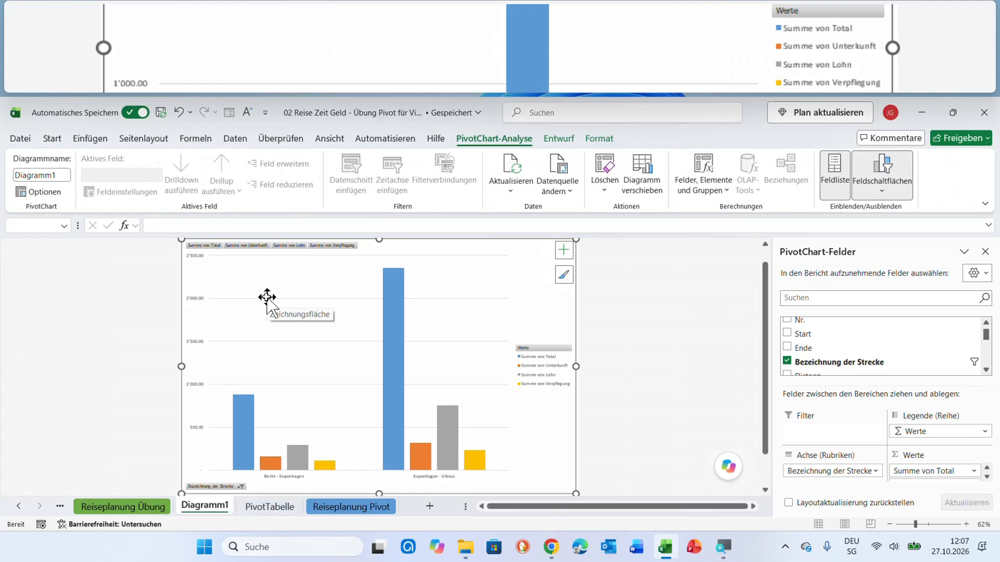

**Ein weiteres Beispiel:** Eine Bilanz in CHF, ausgewertet nach Betrieb und Jahr. Mehrere Felder im Bereich _Zeilen_ ergeben eine Gliederung mit Zwischenergebnissen. Das PivotChart übernimmt automatisch die gleichen Einstellungen (Felder und Filter) wie die Pivot-Tabelle.

| Pivot-Tabelle mit zwei Zeilenfeldern             | Zugehöriges PivotChart                                     |
| ------------------------------------------------ | ---------------------------------------------------------- |
| 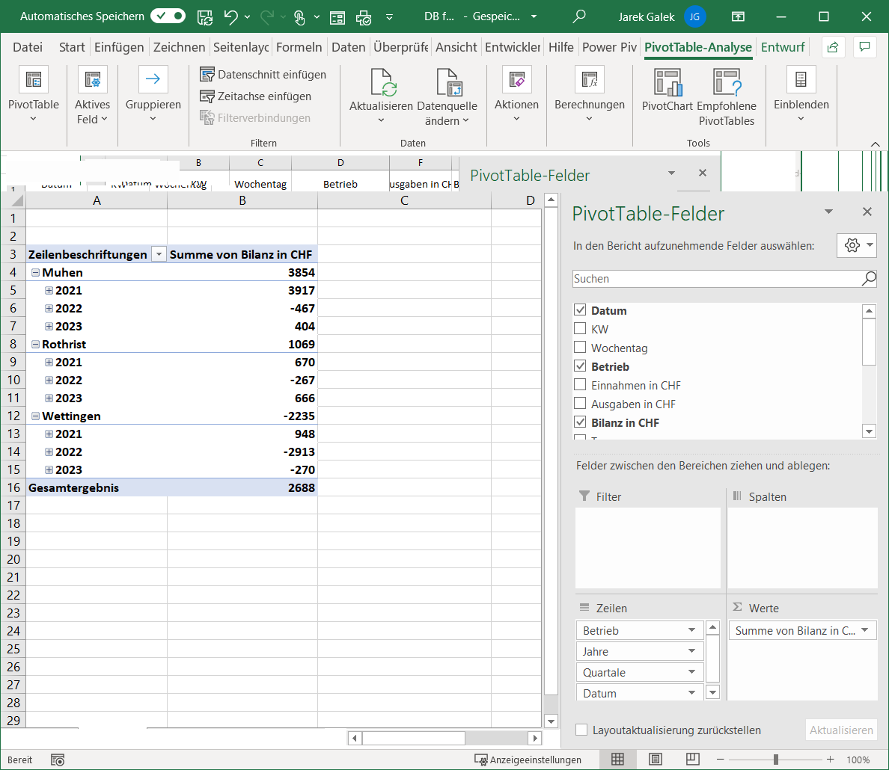 | 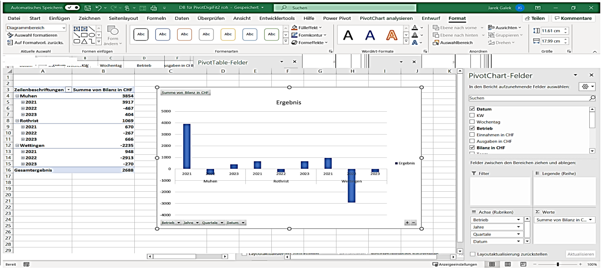 |

_Quelle: J. Galek, Digital Fit – Modul Office fortgeschritten_

> **Wichtig:** Ändern sich die Quelldaten, muss die Pivot-Tabelle **aktualisiert** werden (Rechtsklick → Aktualisieren). Ein Detailauszug ist eine **Momentaufnahme** ohne Verbindung zur Quelle.

---

## 1.12. Videos und Unterlagen

| **Video**                                                                                                | **Inhalt**                                        |
| -------------------------------------------------------------------------------------------------------- | ------------------------------------------------- |
| [Video 1](https://youtu.be/ESK_zabXcmQ)                                                                  | Aufbau der Mappe und Grundwerte                   |
| [Video 2](https://youtu.be/IfKkWmYRm7E)                                                                  | Berechnungen, Zeit und Rundung                    |
| [Video 3](https://youtu.be/0buhSTusklY)                                                                  | Pivot-Tabelle, PivotChart, Detailauszug           |
| [Playlist Excel (Digital Fit)](https://www.youtube.com/playlist?list=PLxSH6SY3ZgVTwQ7uTrOFhY0Yq4qE_RxA_) | Vertiefung: Formate, Daten übernehmen, Funktionen |

| **Unterlage**                                                                                       | **Verwendung**                                                                      |
| --------------------------------------------------------------------------------------------------- | ----------------------------------------------------------------------------------- |
| [Übungsdatei 1 – Reise berechnen](./x_gitres/05_Reise_Zeit_Geld_Uebung_1.xlsx)                      | Übungen 2.2–2.5, 2.8, 2.9                                                           |
| [Übungsdatei 2 – Pivot](./x_gitres/06_Reise_Zeit_Geld_Uebung_2_Pivot.xlsx)                          | Übung 2.6                                                                           |
| [Handout](./x_gitres/03_Handout_Reisen_Zeit_Geld.docx)                                              | Begleitheft zu den Videos                                                           |
| [Wiki – Nachschlagewerk](./x_gitres/02_Wiki_Excel_Reiseplanung_Pivot.docx)                          | Begriffe und Formeln                                                                |
| [Folien](./x_gitres/04_Folien_Reiseplanung_Pivot.pptx)                                              | Präsentation im Unterricht                                                          |
| [Tutorial Office fortgeschritten (J. Galek)](../x_gitres/Tutorial_Office_Fortgeschritten_Galek.pdf) | Nachschlagewerk: Formate S. 9, Daten übernehmen S. 11, Runden S. 22, Pivot S. 34–35 |

---

</br>

# 2. Übungsaufgaben

> Die Übungen bauen **Schritt für Schritt** aufeinander auf: Erst gemeinsam (geführt), dann selbstständig, dann Transfer auf die Baustelle. Arbeiten Sie immer in einer **eigenen Kopie** der Übungsdatei. Den _Spick_ erst zur **Kontrolle** verwenden.

## 2.1. Einstieg: Wo rechnen Sie mit Zeit und Geld?

| **Vorgabe**         | **Beschreibung**                             |
| :------------------ | :------------------------------------------- |
| **Lernziele**       | Vorwissen aktivieren, Praxisbezug herstellen |
| **Sozialform**      | Partnerarbeit, danach Plenum                 |
| **Auftrag**         | siehe unten                                  |
| **Hilfsmittel**     | keine                                        |
| **Zeitbedarf**      | 15 min                                       |
| **Lösungselemente** | 3 Beispiele pro Paar am Whiteboard           |

**Aufgabenstellung:**

Sammeln Sie zu zweit **drei Situationen** aus Ihrem Arbeitsalltag, in denen Zeit in Geld umgerechnet wird. Notieren Sie jeweils: Was wird gezählt (Stunden, km, Tage)? Woher kommt der Ansatz (Tarif, Vertrag, Weisung)?

---

## 2.2. Geführte Übung 1: Strecken zusammensetzen

| **Vorgabe**         | **Beschreibung**                                                                                                          |
| :------------------ | :------------------------------------------------------------------------------------------------------------------------ |
| **Lernziele**       | Datenreihe, relative Bezüge, Text mit `&` verbinden                                                                       |
| **Sozialform**      | Begleitetes Üben                                                                                                          |
| **Auftrag**         | siehe unten                                                                                                               |
| **Hilfsmittel**     | [Übungsdatei – Reise berechnen](./x_gitres/05_Reise_Zeit_Geld_Uebung_1.xlsx), Blatt _Reiseplanung Übung_, Kapitel 1.4–1.5 |
|                     | [Video 2](https://youtu.be/IfKkWmYRm7E)                                                                                   |
| **Zeitbedarf**      | 15 min                                                                                                                    |
| **Lösungselemente** | Spalten A, C und D vollständig                                                                                            |

**Aufgabenstellung:**

1. Erstellen Sie die Nummerierung **1 bis 10** in Spalte A als Datenreihe.
2. Übernehmen Sie in **C2** das nächste Reiseziel mit `=B3` und füllen Sie die Formel bis C10 nach unten.
3. Setzen Sie in **C11** das Ziel der Rückfahrt (`Aarau`).
4. Verbinden Sie in **D2** Start und Ende mit `=B2&" - "&C2` und kopieren Sie die Formel nach unten.
5. **Kontrolle:** Zeigen Sie die Formel in D5 mit F2 an. Welche Zellen werden dort verwendet – und warum?

---

## 2.3. Geführte Übung 2: Fahrspesen und Lohn

| **Vorgabe**         | **Beschreibung**                                |
| :------------------ | :---------------------------------------------- |
| **Lernziele**       | Absolute Bezüge, Blattbezug, Faktor 24          |
| **Sozialform**      | Begleitetes Üben                                |
| **Auftrag**         | siehe unten                                     |
| **Hilfsmittel**     | Übungsdatei 1, Kapitel 1.6–1.7                  |
|                     | [Video 2](https://youtu.be/IfKkWmYRm7E)         |
| **Zeitbedarf**      | 20 min                                          |
| **Lösungselemente** | Spalten G (Fahrspesen) und K (Lohn) vollständig |

**Aufgabenstellung:**

1. Berechnen Sie in **G2** die Fahrspesen: Distanz × Kilometeransatz aus der Legende. Fixieren Sie den Ansatz mit **F4**.
2. Kopieren Sie die Formel bis G11. Prüfen Sie in G7 mit F2, ob der Bezug auf die Legende stehen geblieben ist.
3. Berechnen Sie in **K2** den Lohn: Fahrzeit × 24 × Stundenansatz. Kopieren Sie die Formel nach unten.
4. **Experiment:** Entfernen Sie in einer Kopie der Formel den Faktor 24. Wie gross ist der Lohn jetzt? Erklären Sie den Unterschied Ihrer Nachbarin/Ihrem Nachbarn.
5. **Experiment:** Ändern Sie in der Legende den Kilometeransatz auf 0.80. Was passiert mit Spalte G? Setzen Sie den Wert danach zurück auf 0.72.

---

## 2.4. Kontrollrechnung von Hand

| **Vorgabe**         | **Beschreibung**                                     |
| :------------------ | :--------------------------------------------------- |
| **Lernziele**       | Excel-Ergebnisse unabhängig auf Plausibilität prüfen |
| **Sozialform**      | Einzelarbeit                                         |
| **Auftrag**         | siehe unten                                          |
| **Hilfsmittel**     | Taschenrechner oder Kopfrechnen                      |
| **Zeitbedarf**      | 5 min                                                |
| **Lösungselemente** | Zwei Beträge mit Rechenweg und eine Erklärung        |

**Aufgabenstellung:**

| **Eingabe**     | **Wert**  |
| --------------- | --------- |
| Distanz         | 100 km    |
| Fahrzeit        | 2:30      |
| Kilometeransatz | CHF 0.72  |
| Stundenansatz   | CHF 45.35 |

Berechnen Sie **ohne Excel** die Fahrspesen und den Lohn. Notieren Sie die passenden Excel-Formeln und erklären Sie in einem Satz, wozu der Faktor 24 dient.

Fahrspesen: ____________________    Lohn: ____________________

---

## 2.5. Übung A: Reise vollständig berechnen

| **Vorgabe**         | **Beschreibung**                                                        |
| :------------------ | :---------------------------------------------------------------------- |
| **Lernziele**       | Formeln, Funktionen und Formate selbstständig anwenden                  |
| **Sozialform**      | Einzelarbeit, danach Partnerkontrolle                                   |
| **Auftrag**         | siehe unten                                                             |
| **Hilfsmittel**     | Übungsdatei 1, Kapitel 1.8, Wiki, Spick (erst zur Kontrolle)            |
|                     | [Video 2](https://youtu.be/IfKkWmYRm7E)                                 |
| **Zeitbedarf**      | 20 min                                                                  |
| **Lösungselemente** | Blatt _Reiseplanung Übung_ ohne `???`, geprüft durch eine zweite Person |

**Aufgabenstellung:**

1. Ergänzen Sie in den Zeilen 13–17 für die Spalten **Distanz, Fahrzeit, Fahrspesen und Lohn**: SUMME, MITTELWERT, MAX, MIN und ANZAHL.
2. Formatieren Sie Geldbeträge mit **zwei Dezimalstellen** und die ANZAHL **ohne Dezimalstellen**.
3. Formatieren Sie die Summe der Fahrzeiten mit `[hh]:mm`.
4. Vergleichen Sie Ihre Ergebnisse mit dem Blatt _Reiseplanung Muster_.
5. **Partnerkontrolle:** Tauschen Sie den Platz. Erklären Sie sich gegenseitig je **eine Beispielzeile** (Welche Formel? Welcher Bezug ist fixiert? Warum?).

> **Schnell fertig?** Bearbeiten Sie die Vertiefung [2.7](#27-vertiefung-optional-teilstrecken-pausen-verpflegung-unterkunft).

---

## 2.6. Übung B: Mit Pivot auswerten

| **Vorgabe**         | **Beschreibung**                                                                                  |
| :------------------ | :------------------------------------------------------------------------------------------------ |
| **Lernziele**       | Pivot-Tabelle erstellen, filtern, PivotChart und Detailauszug                                     |
| **Sozialform**      | Begleitetes Üben (Schritte 1–3), danach Partnerarbeit                                             |
| **Auftrag**         | siehe unten                                                                                       |
| **Hilfsmittel**     | [Übungsdatei 2 – Pivot](./x_gitres/06_Reise_Zeit_Geld_Uebung_2_Pivot.xlsx), Kapitel 1.11, Video 3 |
|                     | [Video 3](https://youtu.be/0buhSTusklY)                                                           |
| **Zeitbedarf**      | 30 min                                                                                            |
| **Lösungselemente** | Pivot-Tabelle, PivotChart, notierte Totale, Erklärung Detailauszug                                |

**Aufgabenstellung:**

1. Erstellen Sie aus dem Blatt _Reiseplanung Muster_ (Bereich **A1:M11**, ohne Summenzeilen) eine Pivot-Tabelle auf einem neuen Blatt.
2. **Zeilen:** Bezeichnung der Strecke. **Werte:** Summe von Total, Unterkunft, Lohn und Verpflegung.
3. Filtern Sie auf **Berlin–Kopenhagen** und **Kopenhagen–Vilnius**. Notieren Sie das gefilterte Total: CHF ____________
4. Erstellen Sie mit **F11** (Fn+F11) ein PivotChart mit einem verständlichen Titel inkl. "CHF".
5. Fügen Sie **Sankt Petersburg–Kijv** zur Auswahl hinzu. Notieren Sie das neue Total: CHF ____________
6. Öffnen Sie per **Doppelklick** die Details zu dieser dritten Strecke. Erklären Sie in einem Satz, weshalb dieser Auszug eine **Momentaufnahme** ist.

---

## 2.7. Vertiefung (optional): Teilstrecken, Pausen, Verpflegung, Unterkunft

| **Vorgabe**         | **Beschreibung**                                                      |
| :------------------ | :-------------------------------------------------------------------- |
| **Lernziele**       | AUFRUNDEN/ABRUNDEN anwenden, Rechenreihenfolge beachten               |
| **Sozialform**      | Einzelarbeit (für Schnelle im Unterricht, sonst als Hausaufgabe)      |
| **Auftrag**         | siehe unten                                                           |
| **Hilfsmittel**     | Übungsdatei 1, Kapitel 1.9, Handout Kapitel 9                         |
| **Zeitbedarf**      | 20 min                                                                |
| **Lösungselemente** | Spalten H, I, J, L und M vollständig, Total stimmt mit Muster überein |

**Aufgabenstellung:**

Berechnen Sie die Spalten in **dieser Reihenfolge** (die Unterkunft hängt von den Teilstrecken ab):

| **Reihenfolge** | **Spalte**              | **Regel im Kursmodell**                                                     |
| --------------- | ----------------------- | --------------------------------------------------------------------------- |
| 1               | I – Anzahl Teilstrecken | Fahrzeit ÷ max. Fahrzeit pro Tag, **aufgerundet** auf ganze Zahl            |
| 2               | H – Anzahl Pausen       | Fahrzeit ÷ Fahrzeit bis zur Pause, **abgerundet**, minus (Teilstrecken − 1) |
| 3               | J – Verpflegung         | 2 Personen × Teilstrecken × Verpflegungsansatz                              |
| 4               | L – Unterkunft          | 2 Personen × Teilstrecken × Unterkunftspauschale                            |
| 5               | M – Total               | Fahrspesen + Verpflegung + Lohn + Unterkunft                                |

Formulieren Sie die Formeln zuerst selbst. Kontrollieren Sie erst danach mit dem _Spick_ und dem Handout.

> **Denkfrage:** Die Unterkunft wird pro Teilstrecke gerechnet. Entspricht das der tatsächlichen Anzahl Übernachtungen einer realen Reise? Wo liegt die **Grenze des Modells**?

---

## 2.8. Fehlerjagd

| **Vorgabe**         | **Beschreibung**                                           |
| :------------------ | :--------------------------------------------------------- |
| **Lernziele**       | Fehler in fremden Tabellen systematisch finden und beheben |
| **Sozialform**      | Partnerarbeit                                              |
| **Auftrag**         | siehe unten                                                |
| **Hilfsmittel**     | Übungsdatei 1, Kapitel 1.10, Wiki Kapitel 5                |
| **Zeitbedarf**      | 10 min                                                     |
| **Lösungselemente** | Liste der gefundenen Fehler mit Korrektur                  |

**Aufgabenstellung:**

In der Übungsdatei haben sich (mindestens) **zwei Fehler** versteckt – einer in der **Legende** und einer in einer **Formel** im Blatt _Reiseplanung Übung_.

1. Prüfen Sie die Legende Zeile für Zeile: Passen Wert, Einheit und Bemerkung zusammen?
2. Vergleichen Sie die Formeln in Zeile 2 des Übungsblatts mit denjenigen im Muster (Formeln anzeigen mit Ctrl+`).
3. Notieren Sie pro Fehler: Wo? Was ist falsch? Welche Auswirkung hat er? Wie lautet die Korrektur?

---

## 2.9. Transfer: Baustellenfahrten vergleichen

| **Vorgabe**         | **Beschreibung**                                                 |
| :------------------ | :--------------------------------------------------------------- |
| **Lernziele**       | Gelernte Arbeitsschritte auf eine Baustellensituation übertragen |
| **Sozialform**      | Partnerarbeit (2–3 Personen)                                     |
| **Auftrag**         | siehe unten                                                      |
| **Hilfsmittel**     | Eigene Excel-Datei, Kapitel 1.3–1.8                              |
| **Zeitbedarf**      | 40 min                                                           |
| **Lösungselemente** | Excel-Auswertung mit Legende, Vergleich, zwei Sätze Begründung   |

**Ausgangslage:**

Sie besuchen zwei Baustellen – ohne Verpflegung und Unterkunft. Ansätze: **CHF 0.72/km** und **CHF 45.35/Stunde**.

| **Besuch**  | **Distanz gesamt** | **Fahrzeit gesamt** |
| ----------- | ------------------ | ------------------- |
| Baustelle A | 80 km              | 1:30                |
| Baustelle B | 120 km             | 2:00                |

**Aufgabenstellung:**

1. Erstellen Sie eine neue Excel-Datei mit einem Blatt **Legende** (beide Ansätze) und einem Blatt **Baustellenfahrten**.
2. Berechnen Sie pro Besuch Fahrspesen, Lohn und Total – ausschliesslich mit Bezügen auf die Legende.
3. Vergleichen Sie die beiden Besuche. Ist Baustelle B **nur wegen der Distanz** teurer? Begründen Sie mit Zahlen.
4. Kennzeichnen Sie alle **Annahmen** (z.B. Fahrzeug, Anzahl Personen, Tarif).
5. **Erweiterung:** Wie verändert sich das Total, wenn zwei Mitarbeitende mitfahren (Lohn × 2)? Bauen Sie dafür eine Zelle "Anzahl Personen" in die Legende ein.

---

## 2.10. Selbstcheck und Abgabe

| **Vorgabe**         | **Beschreibung**                        |
| :------------------ | :-------------------------------------- |
| **Lernziele**       | Lernstand sichern, Abgabe kontrollieren |
| **Sozialform**      | Einzelarbeit                            |
| **Auftrag**         | siehe unten                             |
| **Hilfsmittel**     | eigene Dateien                          |
| **Zeitbedarf**      | 10 min                                  |
| **Lösungselemente** | Abgabe in Teams Aufgaben                |

**Selbstcheck – können Sie diese Fragen beantworten?**

1. Warum braucht die Lohnberechnung den Faktor 24?
2. Welcher Bezug muss beim Kopieren fest bleiben – und wie fixieren Sie ihn?
3. Wie zeigen Sie eine Gesamtfahrzeit von über 24 Stunden an?
4. Was ist der Unterschied zwischen SUMME und ANZAHL?
5. Warum dürfen Summenzeilen nicht in der Pivot-Quelle enthalten sein?

**Abgabecheck:**

- [ ] Datei sinnvoll benannt (`Tag01_Nachname_Vorname_Reisebudget.xlsx`), Original unverändert
- [ ] Formeln geprüft, Ansätze fixiert, Zeitformat korrekt
- [ ] Keine `???` und keine Fehlermeldungen mehr
- [ ] Pivot-Filter sichtbar, Diagramm verständlich beschriftet
- [ ] Transferauftrag mit zwei Sätzen zur Auswertung und zur Grenze des Modells ergänzt

---

© 2026 Lukas Müller – Licensed under CC BY-NC-ND 4.0
See [LICENSE](..\license.md) file for details.
